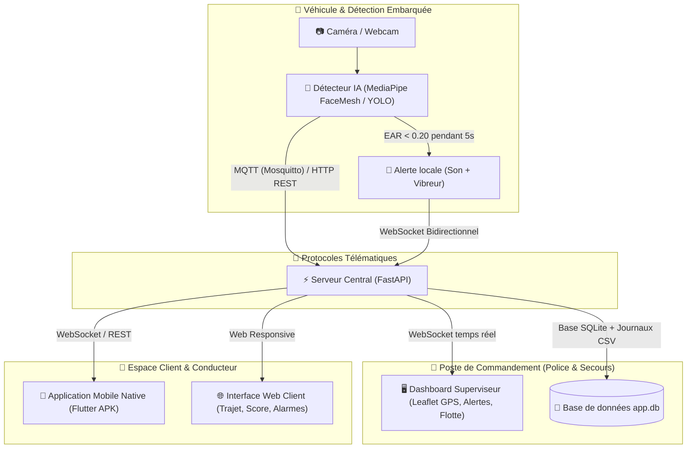

# 🚗 Driver Safety Monitor — Système Intelligent de Surveillance de la Somnolence au Volant

[](https://www.python.org/)
[](https://fastapi.tiangolo.com/)
[](https://flutter.dev/)
[](https://developers.google.com/mediapipe)
[](https://opencv.org/)
[](https://mosquitto.org/)
[](#)

> **Projet de Fin d'Études / Projet Académique — ISSAT Sousse (ISSATSO) 2025-2026**  
> *Surveillance continue de l'attention du conducteur par Vision par Ordinateur, télématique en temps réel (GPS + Vitesse), escalade d'alerte et poste de commandement Police / Secours.*

---

## 📌 Présentation du Projet

Le système **Driver Safety Monitor** est une solution complète d'assistance à la conduite et de prévention des accidents de la route liés à l'endormissement. En analysant le visage du conducteur via une caméra embarquée (ou webcam), le système calcule en temps réel le ratio d'ouverture des yeux (**EAR - Eye Aspect Ratio**).

Dès qu'une somnolence critique est détectée (yeux fermés $\ge 5\text{ s}$), le système déclenche un protocole gradué d'urgence :
1. **Alerte locale immédiate** : Alarme sonore stridente, vibration du smartphone et interface d'urgence rouge plein écran.
2. **Transmission télématique temps réel** : Envoi instantané des coordonnées GPS, de la vitesse et de la capture photo annotée vers le serveur centralisé via WebSocket / MQTT.
3. **Escalade automatique (10 s)** : Si le conducteur n'appuie pas sur le bouton *« Je suis réveillé »*, un appel d'urgence automatique simulé est déclenché avec rapport vocal synthétisé (TTS) et transmission au poste de contrôle de la Police / Protection civile.

> ⚠️ **Note de sécurité** : L'ensemble des appels, SMS et contacts d'urgence sont **simulés** dans le cadre de ce prototype académique (numéro fictif `+216 00 000 000`).

---

## 🏗️ Architecture du Système



---

## 🌟 Fonctionnalités Clés

### 🧠 1. Détection IA Haute Précision
* **Moteur MediaPipe FaceMesh** : Suivi des 468 points de repère faciaux avec calcul ultra-rapide de l'EAR (*Eye Aspect Ratio*).
* **Support Modèle YOLO** : Prise en charge optionnelle d'un modèle customisé entraîné sur Kaggle (`models/eyes_best.pt`).
* **Capture automatique avec preuve** : Enregistrement de l'image JPEG avec boîtes de délimitation rouges sur les yeux au moment précis de l'endormissement.

### 🌐 2. Tableau de Bord Web Moderne
* **Espace Police / Superviseur** :
  * Cartographie interactive multi-véhicules en direct (Leaflet OpenStreetMap avec orientation et vitesse).
  * Journal des alertes critiques avec possibilité de réponse et clôture d'intervention.
  * Historique visuel des détections avec captures photo et export Excel.
  * Gestion de la flotte (véhicules, matricules, conducteurs associés).
* **Espace Client / Conducteur** :
  * Jauge circulaire dynamique de score de vigilance ($0-100\%$).
  * Flux vidéo de la caméra en direct.
  * Suivi de son propre trajet et historique personnel d'alertes.
  * Gestion du profil et des formules d'abonnement.

### 📲 3. Application Mobile Flutter (Android APK)
* Connexion WebSocket temps réel au serveur.
* Notifications prioritaires et maintien de l'écran allumé (*Wakelock*).
* Vibreur haute fréquence et sirène d'alarme d'urgence.
* Compte à rebours interactif de 10 secondes avec annulation en un clic.

---

## ⚙️ Stack Technologique

| Composant | Technologies | Rôle |
|---|---|---|
| **Vision par Ordinateur** | Python 3.9+, MediaPipe 0.10.14, OpenCV, NumPy | Détection faciale et mesure d'ouverture des yeux |
| **Backend & API** | FastAPI, Uvicorn, Python AsyncIO | Serveur temps réel, routage REST, WebSocket |
| **Broker IoT** | Eclipse Mosquitto, Paho-MQTT | Télématique véhicule $\leftrightarrow$ Serveur |
| **Base de Données** | SQLite3, SQLite Async | Stockage persistant des utilisateurs, véhicules, logs |
| **Frontend Web** | HTML5, CSS3 Glassmorphism, Vanilla JS, Leaflet.js, Chart.js | Interface superviseur et client responsive |
| **Application Mobile** | Flutter (Dart 3), Android SDK 36 | Application smartphone native pour conducteur |

---

## 🚀 Installation & Démarrage Rapide

### Prérequis
* **Python 3.9** ou version ultérieure ([Télécharger](https://www.python.org/))
* *(Facultatif)* **Mosquitto MQTT** (`winget install mosquitto`)

### 1. Cloner le projet
```powershell
git clone https://github.com/messelmani765/Driver-Safety-Monitor.git
cd Driver-Safety-Monitor
```

### 2. Créer l'environnement virtuel et installer les dépendances
```powershell
python -m venv .venv
.\.venv\Scripts\Activate.ps1
pip install -r requirements.txt
```

### 3. Lancement en 1 Clic
```powershell
# Option A : Serveur + 3 véhicules simulés (mode standard sans webcam)
.\start_all.ps1

# Option B : Serveur + Détection directe avec votre Webcam
.\start_all.ps1 -Webcam

# Option C : Simulation rapide de somnolence (test d'alerte en 15s)
.\start_all.ps1 -Vehicles 3 -Fast
```

Accédez ensuite au tableau de bord :
* **Sur le PC** : [http://localhost:8000](http://localhost:8000)
* **Sur smartphone (même Wi-Fi)** : `http://IP_DE_VOTRE_PC:8000`

---

## 🔑 Identifiants de Démonstration

| Rôle | Identifiant | Mot de passe | Accès |
|---|---|---|---|
| **Superviseur (Police / PC Sécurité)** | `police` | `police123` | Centre de contrôle global, gestion flotte, carte globale |
| **Conducteur (Client Démo)** | `client1` | `client123` | Espace personnel, alarme embarquée, score, trajet |

---

## 📱 Application Android (APK)

Le fichier APK compilé pour smartphone est disponible :
* 📂 **Emplacement** : `C:\Users\messe\Desktop\Driver-Safety-Monitor.apk` ou dans `flutter_app/Driver-Safety-Monitor.apk`.
* **Installation** : Transférez le fichier sur votre téléphone Android et lancez l'installation (autoriser l'installation d'applications de sources inconnues si demandé).

---

## 📁 Structure du Projet

```text
Driver-Safety-Monitor/
├── detector/               # Scripts de détection IA et simulation
│   ├── detector_eyes.py    # Détection des yeux (MediaPipe FaceMesh)
│   ├── fake_driver.py      # Simulateur de voitures et trajectoires GPS
│   ├── build_route.py      # Générateur de routes réelles (OSRM Sousse)
│   └── utils.py            # Calcul EAR, alertes et transport MQTT/HTTP
├── flutter_app/            # Code source de l'application mobile Android
│   ├── lib/                # Code Dart (pages, alertes, WebSocket)
│   ├── assets/             # Fichiers audio (beep.wav, siren.wav)
│   └── pubspec.yaml        # Dépendances Flutter
├── server/                 # Backend FastAPI et interface web
│   ├── server.py           # Serveur principal (REST + WebSockets + MQTT)
│   ├── db.py               # Gestion de la base SQLite et requêtes SQL
│   ├── alerts.py           # Moteur de règles et d'escalade d'alerte
│   ├── fleet_sim.py        # Gestion de la flotte télématique
│   ├── data/               # Base de données persistante (app.db)
│   └── static/             # Frontend (HTML, CSS, JS, Leaflet, Chart.js)
├── models/                 # Emplacement pour modèles personnalisés (YOLO)
├── mosquitto/              # Configuration du broker MQTT
├── training/               # Scripts d'entraînement des modèles IA
├── requirements.txt        # Dépendances Python
└── start_all.ps1           # Script PowerShell de démarrage automatique
```

---

## 🎓 Auteurs & Remerciements

* **Projet développé à l'Institut Supérieur des Sciences Appliquées et de Technologie de Sousse (ISSATSO)**
* **Année universitaire** : 2025 - 2026
* **Spécialité** : Informatique Industrielle / Génie Logiciel / Systèmes Embarqués

---
*Développé avec passion pour la sécurité routière et la prévention des accidents.*

