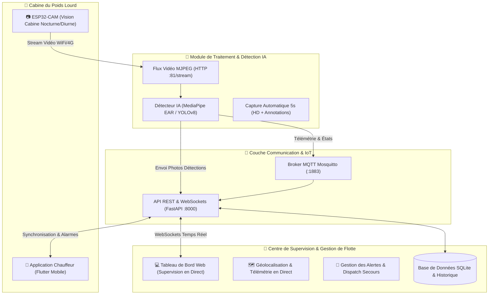
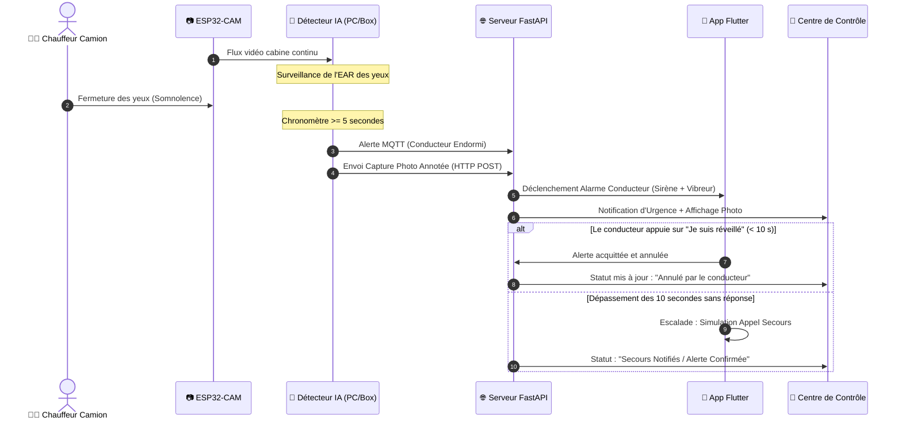

# 🚛 Driver Safety Monitor — Surveillance de Vigilance pour Poids Lourds & Flottes de Camions

[](https://www.python.org/)
[](https://fastapi.tiangolo.com/)
[](https://flutter.dev/)
[](https://opencv.org/)
[](https://developers.google.com/mediapipe)
[](https://mosquitto.org/)
[](https://www.espressif.com/)

---

## 📌 Présentation & Problématique Métier

Le transport routier de marchandises par **poids lourds et grands camions (semi-remorques, citernes, convois)** représente l'épine dorsale de la logistique moderne. Cependant, les chauffeurs routiers sont exposés à des trajets nocturnes prolongés, à la monotonie autoroutière et à une dette de sommeil critique.

> ⚠️ **L'enjeu vital :** Un camion de 40 tonnes lancé à 90 km/h parcourt **125 mètres en 5 secondes**. Un micro-sommeil de quelques secondes équivaut à un projectile incontrôlé, causant des accidents majeurs souvent fatals.

**Driver Safety Monitor** est une solution télématique et d'intelligence artificielle de pointe conçue spécifiquement pour sécuriser les cabines de gros camions en détectant en temps réel les signes d'hypovigilance et d'endormissement, tout en synchronisant les alertes avec le centre d'opérations de la flotte et l'application mobile embarquée.

---

## 🏗️ Architecture Globale du Système



---

## ⚡ Fonctionnalités Clés

### 1. 📷 Module Caméra Cabine (ESP32-CAM)
* **Installation discrète** sur le pare-brise ou le tableau de bord orientée vers le visage du conducteur.
* **Torche LED réglable intégrée** pour assurer une visibilité parfaite même en conduite de nuit.
* **Flux vidéo continu MJPEG** (VGA 640x480, optimisation de bande passante).
* **Reconnexion automatique intelligente** et assignation d'IP fixe pour une robustesse maximale en mobilité.

### 2. 🧠 Intelligence Artificielle & Règle des 5 Secondes
* **Double Moteur de Détection** :
  * **MediaPipe Face Mesh** : calcul ultra-précis de l'EAR (*Eye Aspect Ratio*) sur 468 points faciaux, tolérant aux lunettes et changements de luminosité.
  * **YOLOv8** : modèle personnalisé entraîné sur les états oculaires.
* **Règle d'Endormissement Critique** : si les yeux restent fermés pendant **5 secondes consécutives** :
  * Déclenchement instantané de l'état `Asleep`.
  * **Capture automatique infaillible** de l'image du chauffeur avec surimpression de l'horodatage, de la vitesse, des coordonnées GPS et des boîtes de détection.
  * Transmission immédiate de la preuve photographique au serveur central.

### 3. 🏢 Plateforme Web de Supervision Flotte
* **Carte Interactive en Temps Réel** (OpenStreetMap / Leaflet) : position exacte, cap, vitesse et niveau de vigilance de chaque camion.
* **Galerie de Détections** : consultation chronologique de chaque capture photo d'endormissement, filtrage par véhicule et export des rapports d'incident.
* **Console d'Urgence** : acquittement des alarmes, déclenchement d'assistance et liaison directe avec les services de sécurité / secours.

### 4. 📱 Application Mobile Conducteur (Flutter)
* **Alerte Sonore Haute Intensité** : sirène puissante et vibrations pour sortir le chauffeur de son état de somnolence.
* **Compte à Rebours Interactif de 10 s** : bouton « Je suis réveillé » pour confirmer l'état de conscience.
* **Escalade Automatique** : sans réponse du chauffeur, simulation d'appel d'urgence et transmission des coordonnées précises aux secours routiers.

---

## 🔄 Flux d'Alerte et d'Escalade



---

## 🗂️ Structure du Projet

```text
Driver-Safety-Monitor/
├── demarrer_tout.bat               # 🚀 Lance TOUT en 1 clic (Web + Mosquitto + IA)
├── demarrer_esp32.bat              # Lance le serveur + Détecteur connecté à l'ESP32-CAM
├── demarrer_web.bat                # Lance uniquement le serveur Web de supervision
├── drowsiness-system-v3/
│   ├── config.py                   # Paramètres généraux (seuils, timeouts, alertes)
│   ├── start_all.ps1               # Script d'orchestration PowerShell
│   ├── detector/                   # 🧠 Moteur d'Intelligence Artificielle
│   │   ├── detector_eyes.py        # Détecteur principal (MediaPipe / YOLO + capture auto)
│   │   ├── utils.py                # Chronomètre EyeTimer et utilitaires graphiques
│   │   └── build_route.py          # Générateur de routes et trajectoires GPS
│   ├── esp32_cam/                  # 📷 Code embarqué pour la caméra de cabine
│   │   ├── esp32_cam_driver_safety/
│   │   │   └── esp32_cam_driver_safety.ino  # Firmware Arduino ESP32-CAM
│   │   └── upload_esp32.ps1        # Script de téléversement automatique
│   ├── flutter_app/                # 📱 Application Mobile Conducteur
│   │   ├── lib/                    # Code source Dart / Flutter (écrans, alertes, audio)
│   │   ├── assets/                 # Sons d'alarme (sirène, bip) et logos
│   │   └── Driver-Safety-Monitor.apk # APK Android prêt à installer
│   ├── mosquitto/                  # 📡 Configuration Broker MQTT Mosquitto
│   ├── server/                     # 🌐 Serveur Backend FastAPI & Dashboard Web
│   │   ├── server.py               # Routes REST, WebSockets et télémesure
│   │   ├── alerts.py               # Moteur d'évaluation des alertes et escalade
│   │   ├── db.py                   # Gestionnaire de base de données SQLite
│   │   └── static/                 # Interface Web Frontend (HTML5, CSS3, JS, Maps)
│   └── training/                   # 🎓 Scripts d'entraînement de modèle personnalisé
└── README.md
```

---

## 🚀 Démarrage Rapide

### Prérequis
* **Système d'exploitation** : Windows 10/11 ou Linux.
* **Python** : 3.9 ou supérieur (`pip install -r drowsiness-system-v3/requirements.txt`).
* **Broker MQTT** : Eclipse Mosquitto (optionnel, bascule automatique sur HTTP si non présent).
* **ESP32-CAM** : Téléversé avec le code Arduino fourni, alimenté en 5V.

### Lancement en 1 Clic (Recommandé)
1. Activez le partage de connexion Wi-Fi de votre téléphone (ex: *Redmi Note 13*).
2. Allumez votre module ESP32-CAM.
3. Double-cliquez sur **`demarrer_tout.bat`** (ou `demarrer_esp32.bat`).

Le système lance automatiquement :
* Le broker **Mosquitto**.
* Le serveur web FastAPI sur **`http://localhost:8000`** (ouvre votre navigateur).
* Le moteur d'analyse IA connecté au flux vidéo de la caméra.

---

## 📱 Utilisation de l'Application Mobile

1. Installez le fichier `Driver-Safety-Monitor.apk` situé dans `flutter_app/` sur le smartphone Android du camion.
2. Ouvrez l'application et renseignez :
   * **Serveur / IP** : `IP_DE_VOTRE_PC:8000` (ex: `10.55.27.243:8000`, affichée au lancement du script).
   * **Identifiant** : `client1`
   * **Mot de passe** : `client123`
3. Cliquez sur **« Se connecter à mon compte »**.
4. L'application garde l'adresse en mémoire pour tous les futurs démarrages !

---

## 🛡️ Sécurité & Confidentialité des Données

* **Edge Processing** : l'analyse d'image est effectuée localement sur le boîtier embarqué sans transmettre de flux vidéo continu non sécurisé sur Internet.
* **Captures Ciblées** : seules les images correspondant à un événement avéré d'endormissement (>= 5s) sont archivées à titre de preuve médico-légale et de formation.
* **Authentification Robuste** : séparation stricte des accès Conducteur (application mobile) et Superviseur / Flotte (centre de contrôle).

---

## 👥 Auteur & Contribution

* **Projet** : Driver Safety Monitor — Commercial Fleet Safety System
* **GitHub** : [@messelmani765](https://github.com/messelmani765)
* **Dépôt** : [Driver-Safety-Monitor](https://github.com/messelmani765/Driver-Safety-Monitor)

*Développé pour protéger la vie des chauffeurs routiers et sécuriser les réseaux autoroutiers.*
